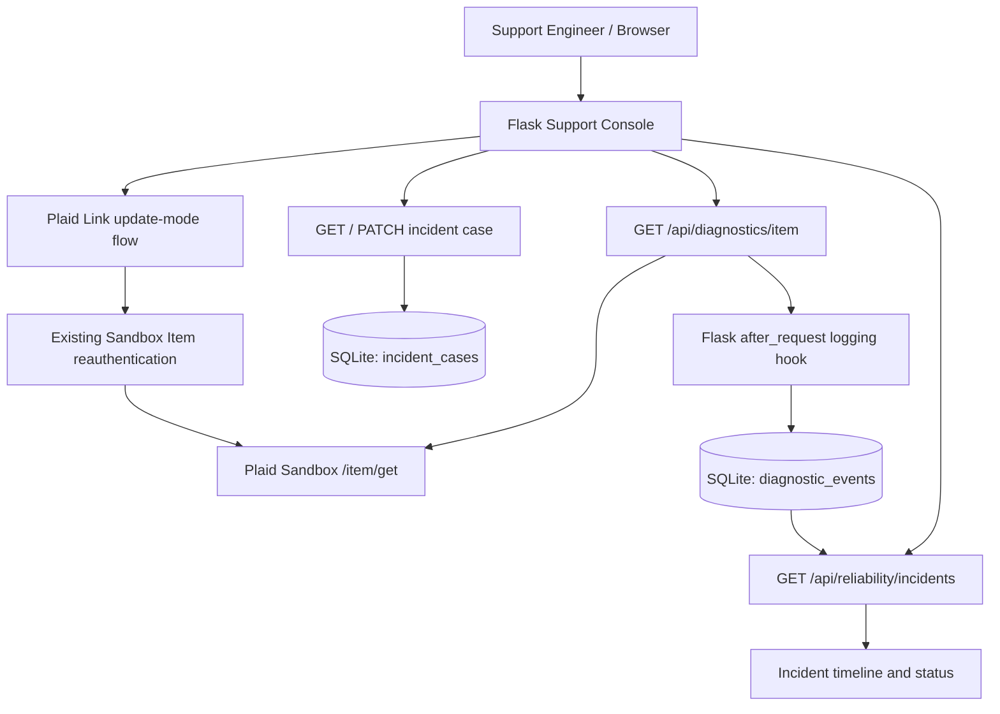

# FinBridge

### Bank Connectivity & API Reliability — Support Engineering Console

FinBridge is a **local, Plaid Sandbox-based support engineering prototype** for diagnosing bank-connection failures, reconstructing incident timelines, guiding connection recovery, and documenting investigations. It turns a reproducible API error into an end-to-end support workflow: **detect → log → investigate → repair → verify → document**.

> **Project scope:** Educational/portfolio application built around a **single Sandbox Item**. It is not a production banking service, a general-purpose account aggregator, or an authenticated multi-user ticketing system.

<!-- After taking a sanitized screenshot, place it in docs/images/support-console.png and uncomment:

-->

## What it does

- **Connection diagnostics:** Calls Plaid Sandbox `/item/get` and classifies a healthy Item, `ITEM_LOGIN_REQUIRED`, other Item errors, upstream API errors, and network failures.
- **Persistent diagnostic history:** Records each diagnostic check in SQLite with status, error details, timestamp, Plaid request ID when present, and HTTP status.
- **Incident reconstruction:** Groups successive Item-error checks into one incident and marks it resolved after a subsequent healthy check. Incident IDs follow the first failing diagnostic event, e.g. `INC-0006`.
- **Investigation timeline:** Opens a selected incident in the browser and displays each failed check plus the recovery event.
- **Case management:** Saves severity (`P1`–`P4`), assigned owner, investigation notes, root cause, and resolution summary in SQLite, separately from diagnostic events.
- **Connection repair:** Launches Plaid Link **update mode** for an existing Sandbox Item requiring reauthentication.
- **Automated tests:** **60 pytest tests reported passing locally** across case management, reliability state logic, Flask routes, diagnostic endpoints, and mocked workflows.

## Example investigation

A Sandbox test Item is placed into `ITEM_LOGIN_REQUIRED` using `/sandbox/item/reset_login`. Two diagnostic checks record `action_required`. The engineer reauthenticates the **existing Item** through Plaid Link update mode. A later healthy check closes the incident and becomes the final event in its timeline. The engineer then saves a root cause and resolution summary.

This flow demonstrates troubleshooting; it does **not** represent a live customer incident or production performance metrics.

## Architecture



The reliability module is deliberately separated from Flask and database I/O; it classifies injected Item responses and rebuilds incidents from saved diagnostic records. The current incident model assumes one connected Item.

## Technology

| Layer | Implementation |
|---|---|
| Web/API | Python 3.12, Flask, HTML/CSS/vanilla JavaScript |
| Banking Sandbox | Plaid `/item/get`, Link update mode, Sandbox login reset |
| Storage | SQLite (`diagnostic_events`, `incident_cases`) |
| Testing | pytest, Flask test client, mocked upstream API responses, temporary SQLite databases |
| Local configuration | `python-dotenv`, environment file excluded from Git |

## Repository structure

```text
FinBridge/
├── repair_item.py                    # Flask application, Plaid diagnostics and repair UI
├── finbridge_reliability.py          # Pure diagnostic classification and incident state logic
├── finbridge_reliability_routes.py   # Read-only incident API backed by SQLite
├── finbridge_case_management.py      # Persistent case metadata API
├── simulate_login_failure.py        # Sandbox-only login-reset helper
├── templates/
│   └── support_console.html          # Diagnostic dashboard, timeline, case editor
├── tests/
│   ├── test_finbridge_cases.py
│   ├── test_finbridge_reliability.py
│   ├── test_finbridge_reliability_routes.py
│   ├── test_finbridge_workflow.py
│   └── test_finbridge_diagnostic_endpoint.py
├── scripts/
│   └── release_preflight.py          # Local pre-publication checks
├── docs/
│   ├── ARCHITECTURE.md
│   └── RELEASE_CHECKLIST.md
├── third_party/
│   └── PLAID_QUICKSTART_LICENSE.txt
├── requirements.txt
├── .env.example
└── .gitignore
```

`finbridge.db`, `.env`, access tokens, and Python virtual environments are intentionally **not** included.

## Local setup

**Requirements:** Python 3.12+, a Plaid developer account with **Sandbox** access, a Sandbox client ID/secret, and an **existing Sandbox Item access token**. This standalone prototype currently expects an existing access token at startup; you can create an Item using Plaid's Quickstart or other supported Sandbox tools. It does **not** yet include a new-Item onboarding workflow.

```bash
# 1. Clone the future repository and enter the project directory
cd FinBridge

# 2. Create an isolated environment
python3.12 -m venv .venv
source .venv/bin/activate

# 3. Install dependencies
python -m pip install -r requirements.txt

# 4. Create a local configuration file (DO NOT COMMIT)
cp .env.example .env
```

Fill in `.env` **locally** with your current Plaid **Sandbox** credentials:

```dotenv
PLAID_CLIENT_ID=your_sandbox_client_id
PLAID_SECRET=your_sandbox_secret
```

Start the application:

```bash
python repair_item.py
```

At startup, paste the **existing Sandbox Item access token** into the hidden terminal prompt. Do not paste it into code, screenshots, Git commits, or issue reports. Then open:

- **Support Console:** http://127.0.0.1:8001/console
- **Connection repair page:** http://127.0.0.1:8001/

The application creates `finbridge.db` locally if needed. A clean database has zero incidents until diagnostic failures are recorded.

## Typical local workflow

1. Open the Support Console and select **Run Health Check** to record the current Item status.
2. For a controlled failure demonstration, run `python simulate_login_failure.py` using the same Sandbox Item access token (Sandbox only).
3. Run another health check and observe `ITEM_LOGIN_REQUIRED` / `action_required`.
4. Select the generated incident to inspect request IDs and the investigation timeline.
5. Use **Repair Connection** to launch Plaid Link update mode and reauthenticate the existing Item.
6. Run a new health check to verify `healthy` and incident resolution.
7. Record case severity, ownership, root cause, and resolution using **Save Case**.

**Note:** Checks are user-triggered; this prototype does not automatically poll Plaid or receive production webhooks.

## API overview

| Method | Endpoint | Purpose |
|---|---|---|
| `GET` | `/console` | Browser Support Console |
| `GET` | `/api/diagnostics/item` | Request fresh Plaid Sandbox Item status; logs a diagnostic event |
| `GET` | `/api/diagnostics/history` | Recent recorded diagnostic events |
| `GET` | `/api/reliability/incidents` | Derived incident summaries |
| `GET` | `/api/reliability/incidents/<incident_id>` | Incident detail with timeline |
| `GET` | `/api/incidents/<incident_id>/case` | Stored case metadata or defaults |
| `PATCH` | `/api/incidents/<incident_id>/case` | Save case metadata |
| `POST` | `/link-token` | Prepare Plaid Link update mode for the existing Item |

Example read-only API call while Flask is running:

```bash
curl -s http://127.0.0.1:8001/api/reliability/incidents | python -m json.tool
```

Example case update after a valid incident exists:

```bash
curl -s -X PATCH http://127.0.0.1:8001/api/incidents/INC-0006/case \
  -H 'Content-Type: application/json' \
  -d '{"severity":"P3","owner":"Support Engineering","investigation_notes":"Sandbox test; reauthentication needed."}'
```

`INC-0006` is an illustrative ID from a local test database; yours may differ.

## Testing

```bash
python -m pytest -q tests/
```

**Latest reported local result:** `60 passed` (October 2026). Tests primarily use mocks and temporary SQLite databases to avoid calling Plaid or modifying the real local incident history. Always rerun the suite after changes; passing tests are not a substitute for production security validation.

## Limitations and security

- **Sandbox and local development only.** Do not deploy the current Flask development server publicly.
- No application authentication, authorization, user isolation, secure session management, or production-grade secret management.
- A single-Item incident model; grouping is by event sequence rather than Item ID.
- Current incident reconstruction treats `action_required` and `error` as incident failures; transport-level `unavailable` / `api_request_failed` statuses are logged but not yet consistently modeled as incidents.
- A recorded `healthy` diagnostic follows the Item response at that point in time; it does not prove bank uptime or guarantee future success.
- Only tested against mocked responses and Sandbox scenarios; does not simulate all real banking network and institution conditions.
- Never commit `.env`, tokens, `finbridge.db`, or exported API responses containing sensitive data. Rotate any credentials previously disclosed outside your local environment.

Run the pre-publication checks documented in [`docs/RELEASE_CHECKLIST.md`](docs/RELEASE_CHECKLIST.md) before the first public push.

## Background and attribution

FinBridge is an independent portfolio extension inspired by and initially developed alongside the official [Plaid Quickstart](https://github.com/plaid/quickstart). Any reused upstream code must retain the applicable notice; Plaid Quickstart is distributed under the MIT License. See [`third_party/PLAID_QUICKSTART_LICENSE.txt`](third_party/PLAID_QUICKSTART_LICENSE.txt).

This project is **not affiliated with, endorsed by, or a production service of Plaid**.

**References:** [Plaid Sandbox](https://plaid.com/docs/sandbox/) · [Plaid Link update mode](https://plaid.com/docs/link/update-mode/) · [Plaid Quickstart](https://plaid.com/docs/quickstart/)
