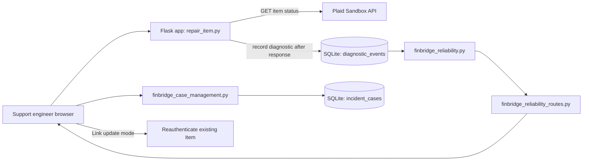
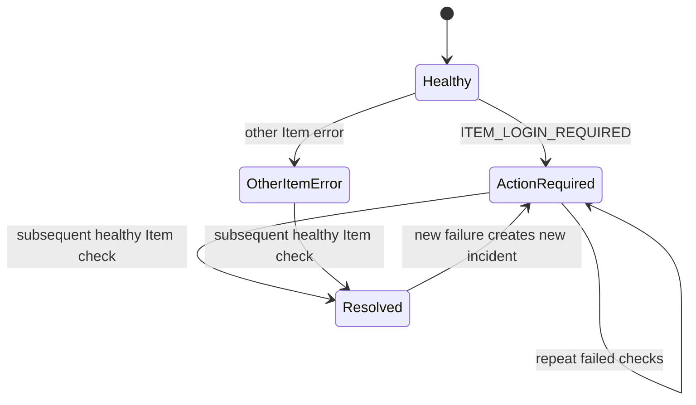

# Architecture and reliability workflow

FinBridge is a local Flask-based support console targeting a single Plaid Sandbox Item.

## Component architecture

## Diagnostic and incident lifecycle

Transport-level failures are currently recorded as diagnostic statuses, but incident reconstruction does not fully classify them as incidents. This is an explicit future improvement.

## Data model

| Table | Key fields | Purpose |
|---|---|---|
| `diagnostic_events` | `id`, `checked_at`, `institution`, `connection_status`, `error_type`, `error_code`, `request_id`, `http_status` | Append-only diagnostic history |
| `incident_cases` | `incident_id`, `severity`, `owner`, `investigation_notes`, `root_cause`, `resolution_summary`, `updated_at` | Editable support case metadata |

**Incident IDs:** The first failing `diagnostic_events.id` is formatted as `INC-0006`. Incidents are rebuilt from ordered events rather than stored in a separate incident table. This is suitable for a one-Item demonstration; production use would require per-Item grouping and durable identity.

## Reliability test boundaries

- Pure unit tests cover classification and event grouping.
- Flask Blueprint tests cover incident and case REST endpoints against isolated SQLite.
- Workflow tests exercise simulated response-to-incident-to-case sequences.
- Diagnostic endpoint tests mock upstream HTTP and exercise Flask response logging.
- Manual Sandbox runs verify Plaid Link update-mode repair and the web interface.

See the main [`README.md`](../README.md) for setup, usage and security limitations.
